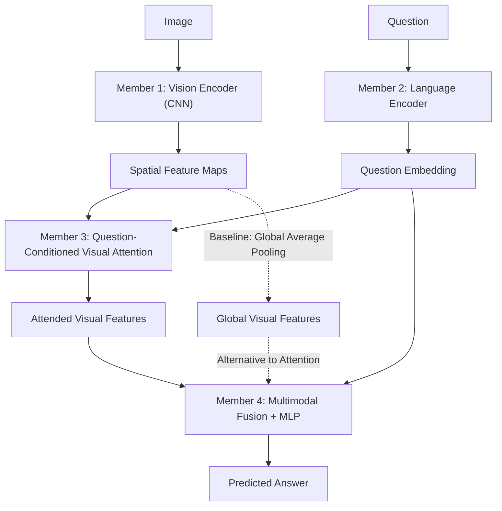

# Week 1 — Theoretical Research & Standalone Implementation

**Project:** Spatial Reasoning VQA with Question-Conditioned Visual Attention

**Objective:** Establish a shared theoretical foundation of Visual Question Answering (VQA), understand the methodology behind each assigned module, and develop standalone prototypes for Week 2 integration.

## 1. Shared Research Paper — Mandatory

**Paper:** [Show, Ask, Attend, and Answer: A Strong Baseline for Visual Question Answering (2017)](https://arxiv.org/abs/1704.03162)

All team members must study this paper to understand the overall VQA architecture and end-to-end workflow.

**Key Research Questions:**
- What problem does VQA solve, and why does it require multimodal learning?
- How are visual and language features extracted and represented?
- How does visual attention use question information to identify relevant image regions?
- How are multimodal features combined to predict an answer?
- What are the advantages of attention over simple feature concatenation?

**Optional Extended Research:** Each member is encouraged to explore additional papers related to their assigned module and share interesting methodologies, architectural improvements, or alternative approaches during the weekly review.

The focus should be on understanding **what problem a methodology solves, how it works, and why it is useful**, rather than simply reproducing a paper.

## 2. Proposed System Architecture

**Architecture Strategy:**
- **Baseline:** CNN + Text Encoder + Global Average Pooling + Concatenation + MLP.
- **Proposed Model:** CNN + Text Encoder + Question-Conditioned Spatial Attention + Fusion + MLP.
- Compare both architectures to investigate whether attention improves spatial reasoning performance.

## 3. Individual Research & Implementation

| Member | Research Focus | Week 1 Deliverable |
|---|---|---|
| **1 — Vision Representation** | CNN, Spatial Feature Maps, Positional Information, Global Average Pooling | CNN Encoder prototype + feature map visualization |
| **2 — Language Representation** | Tokenization, Word Embeddings, Question Encoding, Mean Pooling / GRU | Text Encoder prototype + tokenizer |
| **3 — Visual Attention** | Question-Conditioned Attention, Attention Scores, Weighted Feature Aggregation | Spatial Attention prototype + methodology explanation |
| **4 — Fusion & Answer Prediction** | Feature Fusion, Concatenation, MLP Classification, Gradient Flow | Fusion + Answer Classifier prototype |

**Individual Research Guidelines:**

Each member should be able to explain:

1. **Purpose:** What problem does the assigned module solve?
2. **Methodology:** How does it work? Explain the high-level mathematical and architectural concepts.
3. **Implementation:** How can it be implemented using PyTorch?
4. **Integration:** What inputs does the module require, and what outputs does it produce?
5. **Limitations:** What are its limitations, and what alternative approaches could be explored?

**Note:** Members are encouraged to implement their modules independently using synthetic tensors. Full end-to-end training is not required during Week 1.

## 4. Cross-Review & Knowledge Sharing

Each team member must:

- Understand the complete VQA architecture described in the shared research paper.
- Study at least one module assigned to another member.
- Review its implementation, focusing on conceptual correctness, tensor shapes, and input/output compatibility.
- Prepare **2–3 technical questions** for the reviewed member.
- Document unclear concepts, potential limitations, or alternative methodologies.

**Suggested Peer-Review Pairing:**

- Member 1 → Member 2
- Member 2 → Member 3
- Member 3 → Member 4
- Member 4 → Member 1

## 5. Weekly Technical Review (End of Week 1)

Each member will have **10–15 minutes** to present:

1. **Theory & Methodology (5 min):** Explain the assigned module, its underlying principles, and why the methodology is appropriate for VQA. Additional research papers can be discussed here.
2. **Implementation (5 min):** Demonstrate the standalone prototype, explaining the data flow and input/output tensor shapes.
3. **Discussion (5 min):** Address peer-review questions and discuss unresolved technical challenges or potential improvements.

**Group Discussion:**
- Review the complete proposed VQA architecture.
- Agree on module interfaces, tensor dimensions, question vocabulary, and answer representation.
- Agree on a minimal synthetic dataset format and assign shared data/training setup tasks for Week 2.
- Identify integration dependencies and finalize the Week 2 implementation plan.

## 6. Week 1 — Definition of Done

- [ ] All members have studied the shared VQA research paper.
- [ ] Each member has prepared concise research notes about their assigned module.
- [ ] Each member can explain the module's purpose, methodology, and architectural role.
- [ ] Each module has a standalone prototype or validated demonstration using sample data.
- [ ] Input/output contracts and tensor dimensions have been agreed upon.
- [ ] A minimal dataset schema and answer vocabulary have been defined.
- [ ] Each member has completed at least one cross-module peer review.
- [ ] The baseline architecture and Week 2 integration plan have been finalized.

**Expected Outcome:** By the end of Week 1, all four members should understand the complete VQA architecture, have a solid theoretical understanding of their assigned components, and be prepared to integrate the first end-to-end baseline during Week 2.